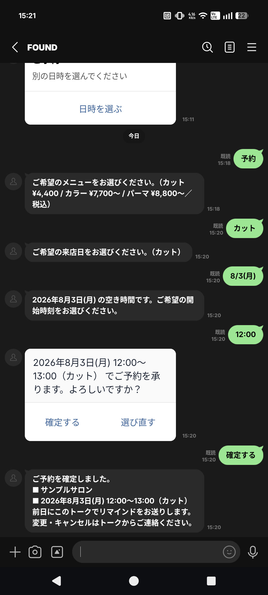
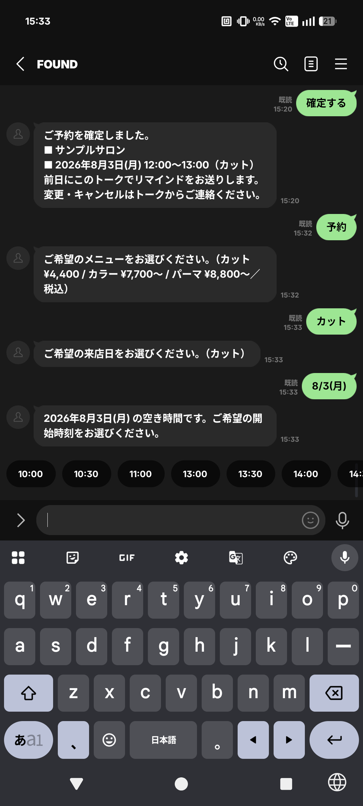
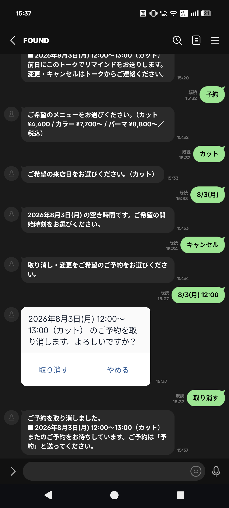

# line-booking-bot

[](https://github.com/Mxhlix/line-booking-bot/actions/workflows/test.yml)

English | [日本語](#日本語)

A Google Apps Script bot for a LINE official account that takes salon reservations inside the chat and answers common questions.
Reservations are recorded in a Google Sheets ledger, and a time that overlaps an existing reservation cannot be booked.

<p>



</p>

Screenshots from an Android phone talking to the bot on a test LINE official account (July 2026). The store 「サンプルサロン」 and its menu are fictional.
Left: the user picks a menu, a date and a start time, and books a cut for 2026-08-03 12:00 to 13:00.
Middle: after that booking, the start times offered for the same day are 10:00, 10:30, 11:00, 13:00, 13:30, 14:00, and more past the edge of the screen. 11:30, 12:00 and 12:30 are not offered, because a 60-minute cut starting then would overlap the booking.
Right: the user sends 「キャンセル」, picks the booking, confirms, and the booking is cancelled.

## What it does

- Receives LINE Messaging API webhooks in `doPost(e)` of a GAS web app and replies to each event.
- Reservation flow in the chat: menu, then date, then start time, then a confirm button. Each step is a set of quick reply buttons.
- Offers only dates and times that are still free. Dates run from tomorrow to 14 days ahead, skip the closed weekday, and show up to 10 days. Start times are in 30-minute steps within opening hours, up to 13 per day.
- The length of a reservation comes from the menu (cut 60 minutes, color and perm 120 minutes in the demo data). A time is refused when its range overlaps an existing reservation, not only when the start time is the same.
- Optional settings: choosing a staff member (counted per staff member), and asking the party size (counted against a seat limit).
- Cancel in the chat: 「キャンセル」 or 「予約確認」 lists the user's own upcoming reservations. After confirming, the ledger row is marked 「キャンセル」 and the time becomes free again. The row is not deleted.
- Keyword replies (hours, access, menu, coupon, phone). Keywords and reply texts are read from the 「よくある質問」 sheet, and store details from the 「設定」 sheet.
- Free questions that match no keyword go to a generative AI (Gemini or Claude, chosen in `CONFIG.AI`). If it cannot answer from the store details, the bot points the user to staff or the phone. In demo mode a fixed set of canned answers is used instead.
- Adds each reservation to Google Calendar. If that fails, the reservation stays in the ledger.
- Reminder the day before (`sendReminders`, run by a daily time trigger). It only sends when `CONFIG.ADDONS.REMINDER` is `true`, which is `false` by default. Sent rows are marked 「済」 so they are not sent twice.
- A demo mode (`DEMO_MODE: true`) that writes replies to the log instead of sending them, and a function `runDemo` that plays a sample conversation.

## Design notes

- Candidate buttons instead of LINE's date-time picker. The picker can only set a minimum, a maximum and an initial value, so it cannot hide times that are already taken. With buttons, only free times can be pressed.
- The bot keeps no conversation state. The choices so far travel inside the postback data (`action=...&menu=...&date=...&time=...`), so pressing an old button again does not break anything.
- The same check (`checkRequest_`) decides which candidates to show and runs again right before saving. A time that was taken in between is refused, and the date choices are shown again.
- Confirming and cancelling are serialized with `LockService`, so two taps at almost the same moment do not both write.
- Cancelling checks that the reservation belongs to the user who sent it. Postback data can be changed on the device, so a user cannot cancel someone else's reservation by sending its ID.
- The channel access token and the AI API key are read from script properties, not written in the code. The Gemini key is sent in a header, not in the URL.
- Sheets turns strings like `2026-07-17` and `14:00` into date and time cells. Reading them back as plain strings broke the comparison. A comment in the code records that this was found on a real device on 2026-07-16. `cellDate_` and `cellTime_` convert them back.
- The webhook signature (`X-Line-Signature`) is not checked. A GAS web app cannot read request headers. `verifySignature_` exists but is not called.

## Verification

GAS does not run locally, so `test/run-tests.js` imitates the GAS globals it needs (spreadsheet, logger, properties, content output) and runs `src/Code.gs` on Node with `vm`, without modification.

Main things checked:

- Keyword replies for hours and prices.
- The whole flow from 「予約」 to a saved ledger row, including menu, date and time candidates and the confirm template.
- A second user cannot book the same time, and a confirm for a time that was taken in between is refused.
- With a 120-minute menu at 14:00, starts at 15:00 and 15:30 are refused and 16:00 is accepted.
- Closed weekday and times that end after closing are refused. The closed weekday is not offered as a date.
- Per-staff counting, and party size against a seat limit of 4.
- Cancel: own reservations are listed, the row becomes 「キャンセル」, the time can be booked again, and another user's reservation ID cannot be cancelled.
- Reminders: none are sent when the option is off, the confirm message does not mention a reminder then, and with the option on each reservation gets one reminder only.
- Date and time cells converted by Sheets (set as `Date` values in the imitation) are still matched for overlap and for reminders.
- Changing the 「よくある質問」, 「設定」 and 「メニュー」 sheets changes the replies.
- `doPost` takes webhook JSON and replies through the log in demo mode. The imitation's HTTP fetch throws, so an accidental send to LINE or an AI API stops the run.

Run on 2026-10-05 with Node.js 24.12.0, all 59 checks passed.

## Getting started

The tests use only Node.js built-ins, with no external packages.
Checked locally on Node.js 24.12.0. On GitHub Actions it passes on Node.js 18, 20 and 22 (2026-10-05).

```
npm test    # run Code.gs in the GAS imitation and check 59 items
```

To run it on GAS, open Extensions > Apps Script in a Google Sheets spreadsheet, add `src/Code.gs` and `src/appsscript.json`, and run the function `runDemo`.
It starts in demo mode. It plays a sample conversation and writes the replies and the ledger to the execution log. Nothing is sent to LINE.
Connecting a LINE official account is in [src/README.md](src/README.md) (Japanese).

`docs/preview.html` is a page to open in a browser. It has its own simplified copy of the store details, keyword replies and canned AI answers in JavaScript, and does not run `Code.gs`. Its reservation part offers two fixed times and shows a full-slot reply when the same time is booked twice. It does not have the menu, date and time buttons of the real flow, and the page says so.

## Project layout

```
src/
  Code.gs            main logic (webhook, replies, reservation flow, overlap check, ledger, cancel, reminders, calendar, AI)
  appsscript.json    manifest (time zone, web app settings and permissions)
  README.md          setup steps for Apps Script and LINE Developers
test/
  run-tests.js       imitation of GAS globals and the tests
docs/
  preview.html                    browser preview of the conversation (simplified, does not run Code.gs)
  04-new-flow-booking.png         menu, date and time buttons: cut booked for 2026-08-03 12:00 to 13:00
  05-overlap-slots-hidden.png     start times for 2026-08-03 after that booking, without 11:30 to 12:30
  06-cancel-flow.png              cancelling that booking from the chat
  07-rebook-perm-120min.png       after cancelling, a perm booked for 2026-08-03 12:00 to 14:00
.github/workflows/test.yml        runs npm test on Node.js 18, 20 and 22
```

## Not yet verified

- All tests in this repository are results in the GAS imitation. The imitation uses the machine's local time zone.
- The screenshots were taken in July 2026. This repository keeps no record of running the current `Code.gs` on a real LINE account after that.
- On the real account, only what the screenshots show was checked: the reservation flow, the full-slot reply, hiding overlapping times, cancelling, and booking a 120-minute menu.
- The confirm messages in the screenshots include the reminder sentence, which appears only when `CONFIG.ADDONS.REMINDER` is `true`. Sending the reminders on a real account is not shown.
- Not checked on a real account: AI replies with a real API key, Google Calendar registration, registering the rich menu (`richMenuJson_`), and `LockService` under simultaneous taps. `LockService` is not present in the imitation, so the tests run without it.
- The webhook signature is not verified on GAS.

## License

MIT. See [LICENSE](LICENSE).

---

## 日本語

LINE公式アカウントで、サロンの予約をトークの中で受け付け、よくある質問に答える Google Apps Script の Bot です。
予約は Google スプレッドシートの台帳に記録し、すでにある予約と時間が重なる枠は予約できません。

<p>


</p>

テスト用の LINE公式アカウントと、Android の実機でやり取りした画面です（2026年7月）。店舗「サンプルサロン」とメニューは架空です。
左は、メニュー・日付・開始時刻を選び、2026-08-03 12:00〜13:00 のカットを予約したところです。
中央は、その予約の後で同じ日の開始時刻の候補を出したところです。10:00・10:30・11:00・13:00・13:30・14:00 と、画面の端より先にも候補が出ています。11:30・12:00・12:30 は出ません。60分のカットをその時刻に始めると、予約と重なるためです。
右は、「キャンセル」と送って予約を選び、確認して取り消したところです。

### できること

- LINE Messaging API の Webhook を GAS のウェブアプリの `doPost(e)` で受け、イベントごとに返信します。
- トークの中の予約は、メニュー、日付、開始時刻、確定ボタンの順に進みます。各段はクイックリプライのボタンです。
- 空いている日と時刻だけを出します。日付は翌日から14日先までで、定休日を除き、最大10日です。開始時刻は営業時間内の30分刻みで、1日最大13件です。
- 予約の長さはメニューで決まります（デモのデータではカット60分、カラーとパーマ120分）。開始時刻が同じときだけでなく、時間の範囲が既存の予約と重なれば受け付けません。
- 設定で、担当者を選ばせること（担当ごとに数える）と、人数を聞くこと（席数の上限と比べる）もできます。
- トークの中で取り消せます。「キャンセル」か「予約確認」と送ると、自分のこれからの予約が一覧で出ます。確認すると台帳の行が「キャンセル」になり、その枠はまた予約できます。行は消しません。
- キーワードに自動で答えます（営業時間・アクセス・メニュー・クーポン・電話）。キーワードと返信文は「よくある質問」シートから、店舗の情報は「設定」シートから読みます。
- どのキーワードにも当たらない質問は、生成AI（Gemini か Claude。`CONFIG.AI` で選ぶ）に渡します。店舗の情報から答えられないときは、スタッフか電話へ案内します。デモモードでは決まった応答をいくつか返すだけです。
- 予約を Google カレンダーに登録します。登録に失敗しても、予約は台帳に残ります。
- 前日のリマインドを送れます（`sendReminders` を毎日動くトリガーで実行）。`CONFIG.ADDONS.REMINDER` が `true` のときだけ送り、既定は `false` です。送った行は「済」にして、二度送りません。
- デモモード（`DEMO_MODE: true`）では、返信を送らずにログへ書きます。関数 `runDemo` で見本の会話を流せます。

### 設計で気をつけたこと

- **LINE の日時選択ではなく候補のボタンにした。** 日時選択は最小値・最大値・初期値しか決められず、埋まった時刻を選べなくすることができません。ボタンなら、押せるのは空いている時刻だけです。
- **会話の途中の状態を Bot 側に持たない。** それまでの選択はポストバックのデータ（`action=...&menu=...&date=...&time=...`）に載せて持ち回ります。古いボタンを押し直しても壊れません。
- **候補を出す判定と、確定直前の判定を同じにした。** どちらも `checkRequest_` を通します。候補を出してから押されるまでに埋まった枠は断り、日付の候補を出し直します。
- **確定と取り消しを直列にした。** `LockService` を使い、ほぼ同時に押されても両方が書き込まないようにしています。
- **取り消しの前に本人の予約か確かめる。** ポストバックのデータは端末側で書き換えられます。他人の予約IDを送っても取り消せません。
- **トークンとキーはスクリプト プロパティに置く。** チャネルアクセストークンと AI の API キーはコードに書きません。Gemini のキーは URL ではなくヘッダで渡します。
- **シートの型の自動変換を吸収する。** シートは `2026-07-17` や `14:00` の文字列を日付・時刻のセルに変えます。文字列のまま読むと照合が外れました。コードのコメントには、2026-07-16 に実機で見つかったと書いてあります。`cellDate_` と `cellTime_` で元の形に戻して比べます。
- **Webhook の署名は確かめていない。** GAS のウェブアプリはリクエストのヘッダを読めません。`verifySignature_` はありますが、呼んでいません。

### 検証

GAS はローカルでは動かないので、`test/run-tests.js` で必要な GAS の機能（スプレッドシート・ログ・プロパティ・応答の出力）を模擬し、`src/Code.gs` を書き換えずに Node の `vm` で実行して確かめています。

主に確かめていること:

- 営業時間と料金のキーワードへの応答。
- 「予約」から台帳の記録までの流れ。メニュー・日付・時刻の候補と確認の表示を含みます。
- 別のユーザーが同じ枠を予約できないこと。候補を出した後に埋まった枠の確定を断ること。
- 120分のメニューを14:00で入れると、15:00と15:30の開始は断り、16:00は受けること。
- 定休日と、閉店時刻を過ぎて終わる時刻を断ること。定休日が日付の候補に出ないこと。
- 担当ごとの数え方と、席数4の上限に対する人数の数え方。
- 取り消し。自分の予約が一覧に出て、行が「キャンセル」になり、その枠がまた予約でき、他人の予約IDでは取り消せないこと。
- リマインド。オプションが無効なら送らず、確定の文面でもリマインドに触れないこと。有効なら1件につき1回だけ送ること。
- シートが日付・時刻のセルに変えた値（模擬では `Date` を入れて再現）でも、重なりとリマインドの照合が合うこと。
- 「よくある質問」「設定」「メニュー」シートを書き換えると応答が変わること。
- `doPost` が Webhook の JSON を受け、デモモードでは返信をログに出すこと。模擬の HTTP 送信は呼ばれると例外を投げるので、LINE や AI の API へ誤って送るとテストが止まります。

2026-10-05 に Node.js 24.12.0 で実行し、59項目すべて合格しました。

### 動かし方

テストは Node.js の標準機能だけで動き、外部のパッケージは使っていません。
手元で確かめたのは Node.js 24.12.0 です。GitHub Actions では Node.js 18・20・22 で通っています（2026-10-05）。

```
npm test    # GAS を模擬した環境で Code.gs を動かし、59項目を確かめる
```

GAS で動かすときは、Google スプレッドシートの拡張機能 > Apps Script に `src/Code.gs` と `src/appsscript.json` を入れて、関数 `runDemo` を実行します。
最初はデモモードになっていて、見本の会話を流し、返信と台帳を実行ログに書きます。LINE には何も送りません。
LINE公式アカウントとのつなぎ方は [src/README.md](src/README.md) にあります。

`docs/preview.html` はブラウザで開くページです。店舗の情報・キーワードの返信・AI の決まった応答を JavaScript で簡単に写したもので、`Code.gs` は動かしていません。予約の部分は決まった2つの時刻を出し、同じ時刻を2回予約すると満席の返信を出します。本物の流れにあるメニュー・日付・時刻のボタンは無く、そのことはページにも書いてあります。

### フォルダ構成

```
src/
  Code.gs            本体（Webhook・返信・予約の流れ・重なりの判定・台帳・取り消し・リマインド・カレンダー・AI）
  appsscript.json    マニフェスト（タイムゾーン・ウェブアプリの設定・権限）
  README.md          Apps Script と LINE Developers の設定手順
test/
  run-tests.js       GAS の機能の模擬とテスト本体
docs/
  preview.html                    会話のブラウザ用プレビュー（簡易版。Code.gs は動かさない）
  04-new-flow-booking.png         メニュー・日付・時刻のボタンで、2026-08-03 12:00〜13:00 のカットを予約
  05-overlap-slots-hidden.png     その予約の後の 2026-08-03 の開始時刻の候補。11:30〜12:30 が無い
  06-cancel-flow.png              その予約をトークから取り消す
  07-rebook-perm-120min.png       取り消しの後、2026-08-03 12:00〜14:00 のパーマを予約
.github/workflows/test.yml        Node.js 18・20・22 で npm test を動かす
```

### まだ確かめていないこと

- このリポジトリのテストは、すべて GAS を模擬した環境での結果です。模擬は手元のマシンのタイムゾーンで動きます。
- 画面は2026年7月に撮ったものです。それより後に、今の `Code.gs` を本物の LINE アカウントで動かした記録は、このリポジトリには残していません。
- 本物のアカウントで確かめたのは、画面に写っている範囲だけです。予約の流れ、満席の返信、重なる時刻を出さないこと、取り消し、120分のメニューの予約です。
- 画面の確定メッセージにはリマインドの文が入っています。これは `CONFIG.ADDONS.REMINDER` が `true` のときだけ出る文です。本物のアカウントでリマインドを送ったところは写っていません。
- 本物のアカウントでは次を確かめていません。本物の API キーでの AI の返信、Google カレンダーへの登録、リッチメニュー（`richMenuJson_`）の登録、同時に押されたときの `LockService` の動き。模擬には `LockService` が無いので、テストはこれ無しで動きます。
- GAS では Webhook の署名を確かめていません。

### ライセンス

MIT です。[LICENSE](LICENSE) を見てください。
